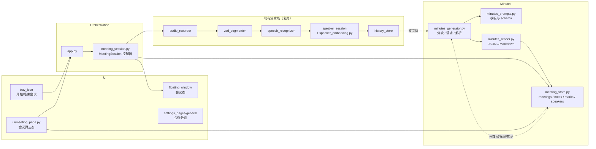
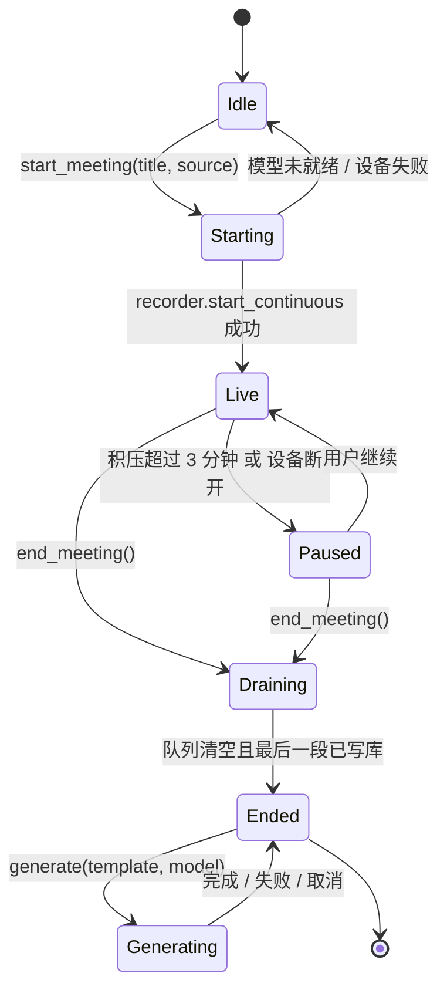

# SayInk AI 会议纪要：业界调研与产品功能设计方案

> 2026-10-23 补充：D6 扩展为“默认不保存音频，可显式开启独立的本机录音恢复；声纹始终不落盘”。
> 本文其余“不保存 / 不落盘”音频约定描述默认配置；新开关、清理策略及限制见
> [连续讲话优化验收](recognition-optimization-completion-20261023.md)。仍不提供任意文件导入。

| 项 | 内容 |
|---|---|
| 状态 | 会议工作台已在 **2.2.5** 落地（列表、文字稿、纪要、六套模板、说话人改名与单段纠正）。**仍未完成：** 真实会议的 CER / RTF 基线、说话人拆人 / 并人标定。排期以 §5.8.0 为准；§1.2 与下文里「未实现 / 参数全部留空」是 2026-10-17 的设计快照 |
| 日期 | 2026-10-17 设计；2026-10-18 按代码修订状态 |
| 基线版本 | 设计时 2.2.4；当前 `sayink/version.py` 为 **2.2.5** |
| 范围 | 在 SayInk 内新增「会议」能力：实时听会 → 带说话人的文字稿 → 会后一键生成结构化纪要 → 编辑 / 重生成 / 导出 Markdown |
| 不在范围 | 导入本地录音文件；保存会议音频；实时逐分钟纪要；飞书 / 钉钉 / Notion 推送；对会议内容追问（Chat） |

## 0. 已确认的产品决策

以下决策来自 2026-10-17 与产品负责人的两轮问答，是本方案的前提：

| # | 决策 | 结论 |
|---|---|---|
| D1 | 会议内容来源 | 只针对 SayInk 实时听到的会议（麦克风 / 电脑播放 / 混合），**不**重新引入文件导入（与 2026-07-15 移除文件转写与 ffmpeg 的决策保持一致） |
| D2 | 生成纪要的大模型 | 复用现有 OpenAI 兼容 API 配置（DeepSeek / 通义 / Ollama 等），纪要可单独选模型 |
| D3 | 生成时机 | 会议结束后一键生成；会中不做滚动纪要。2026-10-21 增补：可选「会议结束后自动生成纪要」（默认关），按默认模板在后台逐场排队生成，手动请求排在自动任务前面且不打断当前任务，见 [排队与自动生成](meeting-generation-reliability.md#排队与自动生成) |
| D4 | 纪要内容 | 整体摘要、分议题要点、决策、待办（负责人 / 截止）、遗留问题、带时间戳的章节、按说话人的发言摘要；模板 / 提示词可自定义 |
| D5 | 说话人识别 | 升级为 sherpa-onnx 说话人嵌入模型（可选 pyannote 分段），取代现有频谱粗分 |
| D6 | 音频 | **默认不保存音频**，只存文字稿与纪要；显式开启录音恢复时允许独立本机缓存，声纹始终不落盘 |
| D7 | 形态与入口 | 新增「会议」侧栏页 + 独立「开始会议」入口（主窗口 / 托盘 / 可选快捷键），与日常转写明确区分；Alt+X 仍是日常转写，会议中互斥提示 |
| D8 | 输出 | 复制 Markdown / 导出 .md |
| D9 | 典型会议 | 中文为主、偶尔中英混杂，30–90 分钟线上会议（腾讯会议 / 飞书 / Teams） |
| D10 | 会前信息 | 可选、可跳过：一键开始，会中 / 会后随时补标题、参会人 |
| D11 | 会中界面 | 实时滚动文字稿（带说话人、时间）+ 会中可打「标记」/ 随手笔记 |
| D12 | 会后编辑 | 纪要可直接编辑保存；可换模板 / 模型重新生成；说话人改名后文字稿与纪要同步 |
| D13 | 交付物 | 本设计文档；本次不写代码 |
| D14 | 文字稿质量（2026-10-17 第二轮评审） | 采纳 ASR 准确率改进建议并入本方案：会议模式启用神经 VAD、词表三处注入（ASR 热词 / 同音替换、润色、纪要）、会议独立选模型、片段采集时刻提前到 M1、建立 CER / RTF 评测基线（§5.8）；默认模型暂不更换，由基线决定 |

---

## 1. 背景与目标

### 1.1 现状：SayInk 已经有「听会」的一半

| 已有能力 | 位置 | 对会议纪要的意义 |
|---|---|---|
| 持续转写（VAD 切分、15 s 安静处分片、收尾 flush、按序 识别 → 润色 → 写历史） | `app.py` `_on_segment_ready` / `_begin_transcription` / `_output_text` | 会议文字稿的生产线已经存在，可直接复用 |
| 仅电脑播放 / 混合采集，并自动切为「只记录到历史」 | `audio_recorder.py`、`config.set_output_mode(auto=True)` | 听线上会议不会误粘贴到前台窗口 |
| 场内说话人编号（最多 8 人，不落盘） | `speaker_session.py` + `history.speaker_id / speaker_route` | 数据结构已预留，但算法是 24 维 mel 频谱的粗略聚类，README 明确「请勿当作可靠的发言人记录」 |
| OpenAI 兼容 LLM 调用、HTTPS / 局域网 HTTP 策略、Key 存凭据管理器 | `text_polisher.py`、`secret_store.py` | 纪要生成可复用连接与安全策略；但润色是 15 s 超时、2048 token 的短请求，纪要需要另一条长请求通道 |
| SQLite 历史（按 session 管理）、Markdown 导出、按天分组、搜索 | `history_store.py`、`ui/history_window.py` | 会议文字稿可以继续落在 `history` 表；纪要需要新表 |
| 主窗口侧栏五页 + 转写条 + 托盘 | `ui/main_window.py`、`floating_window.py`、`tray_icon.py` | 新增一页「会议」和会议态转写条即可 |

### 1.2 缺口

**本节是 2026-10-17 设计时的缺口，不是当前代码状态。** 会议对象、纪要、说话人改名、Silero、热词与语种（部分模型）、混音配平、词表入口都已在 2.2.5 落地。仍空的是真实语料上的 CER / RTF，以及说话人拆人 / 并人标定，见 §5.8.0。

按「对纪要质量的影响 × 实现成本」排序；编号在后文引用。

1. **文字稿质量是纪要的上游，而现有识别链路没有为长时多人场景调优。** 一句口述里的错字用户当场就改，一小时文字稿里的错字会直接变成纪要里的错人、错数。具体缺口（代码事实见 §5.8）：
   - 模型自带的准确率参数一个都没传：`from_funasr_nano` / `from_qwen3_asr` 的 `hotwords`、`from_funasr_nano` / `from_sense_voice` 的 `language`、Paraformer / SenseVoice / FireRedASR 的同音替换器（`hr_*`）与 ITN 规则（`rule_fsts`）全部留空（`speech_recognizer.py` `_create_recognizer`）；语种漂移目前靠事后正则过滤。
   - VAD 是 RMS 能量门限（`vad_segmenter.py`，`SPEECH_RMS_THRESHOLD = 0.002` + 自适应底噪），不是神经网络 VAD；键盘声、空调、远端回声会切碎或吞掉起音。
   - 混合采集把两轨平均（`audio_utils.mix_to_mono`，各轨幅度减半），而「仅电脑播放」模式单独有 ×2.5 增益；远端语音在混合模式下更弱、更靠近 VAD 门限。
   - 没有任何 CER / RTF 评测基线（README 自述「没有公开的统一评测」），模型切换、热词、VAD 的收益都无法度量。
   - 没有词表（人名、产品名、项目代号）的产品入口。
2. **没有「一场会议」这个对象，也没有片段的采集时刻。** 没有标题、参会人、开始 / 结束时间、标记、笔记，只有一串片段；`_SegmentContext` 不记录片段的采集开始时间，`history.created_at` 是识别完成时间——章节跳转、待办溯源、说话人改名核对都需要准确的相对时间戳。与之相伴：转写条和托盘没有「会议中」状态；历史保留策略（90 天 / 5000 场）会把会议连同文字稿一起清掉。
3. **没有纪要**：历史页能看逐句文字，不能得到摘要 / 决策 / 待办。
4. **没有面向长文本的 LLM 调用**（分块、长超时、结构化输出、失败不丢稿）。
5. **说话人不可靠，也不能改名**——这是两件事：
   - 5a. 聚类算法弱：24 维 mel 频谱 + 余弦阈值，README 明确「请勿当作可靠的发言人记录」；由嵌入模型解决（D5）。
   - 5b. 混合模式下「我 / 对方」的路由靠两轨能量比猜（`speaker_session.dominant_route`，3:1 判定），本应是确定值。若会议模式两轨分别识别（§3.3），路由不再需要猜，嵌入模型只需区分「对方」里的多个人。

### 1.3 目标与成功标准

- **目标**：用户在任意会议软件里开会时，点一下「开始会议」，会后 1–2 分钟内拿到一份可直接发到群里的中文纪要；全程不装 bot、不上传音频、ASR 本地完成，只有文字稿按用户的明确选择发给其配置的大模型。
- **成功标准（可验证）**：
  1. 60 分钟中文线上会议（混合采集），结束后点击「生成纪要」，在 DeepSeek-V3 级别模型上 ≤ 90 s 出稿，失败时文字稿完整保留且可重试。
  2. 纪要包含 D4 列出的全部区块；待办中出现的人名 / 日期必须能在文字稿里找到出处（提示词约束 + 规则抽检）。
  3. 说话人：两人以上会议中，用新嵌入模型后「同一人被拆成多个编号」与「不同人被并成一个编号」的比例显著低于现有频谱法（以 3 段真实录音人工标注为基准，设计阶段先定测量方法，见 §7）。
  4. 会议过程中 Alt+X 日常转写被阻止并有提示；会议结束后日常转写恢复，输入源、输出模式回到会前设置。
  5. 不新增任何音频落盘；关闭 SayInk 时未结束的会议不丢已识别文字。
  6. 文字稿质量：在 §5.8 的评测基线上，会议模式（神经 VAD + 词表注入）相对现状在同一模型下 CER 下降，且词表中的词条命中率（出现次数 / 应出现次数）≥ 90%；RTF 不高于现状的 1.2 倍。
  7. 每个片段带采集开始时刻，纪要里的时间戳与文字稿行对齐误差 ≤ 2 s。

### 1.4 非目标（本期明确不做）

导入录音 / 视频文件；保存录音回放；实时字幕翻译；会中每隔几分钟刷新的实时纪要；自动检测会议软件并提示开始；第三方平台推送；对会议内容的多轮问答；跨场次声纹记忆（「记住谁是谁」）。这些列入 §6 的后续阶段候选。

---

## 2. 业界调研

调研方式：Exa 网页搜索 + Jina 阅读官方帮助中心 / 评测文章，sherpa-onnx 官方文档与 GitHub Release；检索时间 2026-10-17。来源见附录 A。

### 2.1 国内产品

| 产品 | 形态 | 转写 / 说话人 | 纪要能力 | 对 SayInk 的参考点 |
|---|---|---|---|---|
| **通义听悟**（阿里） | 云服务 + API；实时记录与文件转写两种模式 | 中 / 英 / 粤 / 日 / 韩，热词；离线说话人分离「不分离 / 2 人 / 多人」 | 全文摘要、**章节速览**（分割 + 标题 + 章节摘要）、**发言总结**（按说话人）、问答回顾、待办（最多 6 条）、关键词、思维导图、口语书面化、自定义 Prompt；多轮 LLM 优化待办提取；可选 qwen-plus 等模型 | 区块划分最完整，是 D4 的直接参照；「发言总结需先开说话人分离」说明说话人是纪要质量前提 |
| **飞书妙记 / 智能会议纪要** | 飞书会议内置 + 本地音视频上传 | 发言人识别，会议室场景支持**声纹**实时识别身份 | 会中实时总结、会后纪要、章节纪要可点击跳转、待办含责任人并**可溯源到原文**、待办一键转飞书任务、按会议类型「千会千面」模板、可视化表格 / 流程图 | 待办溯源、章节跳转、模板按会议类型切换是用户感知最强的三点 |
| **讯飞听见 / 讯飞会议** | 独立 App + 硬件 | 中文 / 方言准确率标杆，10+ 人区分，热词与专业领域 | AI 纪要（模板不可自定义提示词）、思维导图、AI 助手问答、实时翻译 | 纪要被评价为偏「流水账」：说明只有转写好不够，提示词结构决定纪要可读性 |
| **腾讯会议 AI 小助手 / 元宝纪要** | 腾讯会议内置 | 中文准确率高，发言人区分弱于讯飞、通义 | 会中实时字幕 + 要点、会后即时纪要、待办提取；强在实时性 | 典型「平台内置」：离开腾讯会议就没有；SayInk 的价值是跨会议软件 |
| **钉钉 AI 听记 / 闪记** | 钉钉内置 + 移动端 | 区分发言人 | 纪要、章节、发言人、待办；**支持模板与自定义提示词模板** | 自定义提示词已是国内产品的常规项 |

评测文章的共同结论（TAIM.PLUS 2026-06 四款实测、腾讯云开发者社区 2026-06 两篇）：
- 四强共同短板：重度方言 / 嘈杂环境下转写下降；**待办提取依赖发言人明确说「谁做什么」，隐含分工难捕捉**；白板 / 图表内容无法识别。
- 用户选择逻辑是「跟着生态走」：用飞书选妙记，用钉钉选听记，用腾讯会议选 AI 小助手。独立工具（听悟、听见）靠准确率和文件处理能力立足。
- 「纪要效果不佳 / 流水账」是高频抱怨，说明**纪要提示词与结构**是差异化点，不只是 ASR。

### 2.2 国际 SaaS

| 产品 | 采集方式 | 说话人 | 纪要与后续 | 要点 |
|---|---|---|---|---|
| **Granola** | **无 bot**，桌面 App 采集麦克风 + 系统音；不保存音频，不支持导入文件 | 会议软件内取参会人显示名；否则 **Me / Them**（麦克风 vs 系统音），AI 再按上下文推断 | 用户会中的**手写要点引导 AI**；会后自动生成「增强笔记」；每条笔记可用放大镜**回溯到文字稿出处**；内置 + 自定义模板；可重新生成；Chat 修改笔记；15 分钟无声自动停止 | 与 SayInk 定位最接近（桌面、无 bot、不存音频、live-only）。「Me / Them」与 SayInk 的 `speaker_route` 完全对应 |
| **Fathom** | bot 或无 bot | 有 | 摘要分 key points / decisions / action items，被多篇评测评为「信号最多、废话最少」；免费无限 | 纪要区块应少而准 |
| **Otter.ai** | bot + 文件导入 | 有 | 实时转写最成熟；摘要含决策与待办；跨会议 Chat | 中文为 6 个支持语种之一；bot 误入会议是主要抱怨 |
| **Fireflies.ai** | bot + API | 有 | 100+ 语种、CRM 自动回填、AskFred | 集成重；免费版文字稿只留 3 个月 |
| **tl;dv** | bot + 移动端 | 有（大会议常认错） | 会中打时间戳 + 片段分享；AI 摘要一般；无 DOCX / SRT 导出，文字稿不可编辑 | 「会中打标记」是低成本高价值交互 |

共识：所有 bot 类产品都无法隐身，参会者能看见；评测普遍把「无 bot、本地采集」列为优势。

### 2.3 本地 / 开源方案（与 SayInk 定位最接近）

| 项目 | 技术栈 | 转写 | 纪要 | 说话人 | 借鉴 |
|---|---|---|---|---|---|
| **Meetily**（MIT，Win + mac） | Tauri | 本地 Whisper / Parakeet；也可接 OpenAI 兼容转写服务 | 可插拔：Ollama / 内置小模型 / BYOK（Claude、OpenAI、Groq）；按 LLM 供应商公布数据留存说明 | 有 | 「音频永不离开本机，只有文字稿按选择发给云端 LLM」的隐私叙事与 SayInk 一致；设置里为每个 LLM 供应商写清数据留存值得借鉴 |
| **Hyprnote → Anarlog**（YC S25，开源，mac 为主） | Tauri + Rust | 本地 Whisper | 默认本地 HyprLLM（Qwen3 1.7B 微调），可换 Ollama / LM Studio / 云 Key | 有 | 「会中手写笔记 + 文字稿 → 会后增强」同 Granola；社区强烈要求 Markdown / Obsidian 导出、日历集成；小模型纪要质量被认为「够用但非最佳」 |

### 2.4 功能基线（table stakes）与差异化

**所有主流产品都有（SayInk 必须有）**：实时文字稿、说话人区分、会后结构化纪要（摘要 / 要点 / 决策 / 待办）、模板、可编辑、可重新生成、导出或复制。

**头部产品的差异化（SayInk 可选择性跟进）**：
1. 待办 / 要点**溯源到原文**（飞书、Granola）→ 本方案用「每条要点附时间戳」低成本实现。
2. **用户笔记引导生成**（Granola、Hyprnote）→ D11 的标记 / 随手笔记正是为此。
3. 章节划分 + 点击跳转（通义、飞书）→ D4 已含时间线章节。
4. 按说话人的发言总结（通义、飞书）→ D4 已含。
5. Chat / 问答、CRM / 任务系统集成 → 非目标。

**SayInk 的差异化位置**：Windows 原生、无 bot、ASR 完全本地（9 款模型可选）、不存音频、跨会议软件、BYO LLM（含纯本地 Ollama）。国内同定位（本地 + 跨平台 + 自带模型）的桌面产品几乎空白；国际上 Meetily / Hyprnote 以 Whisper 为主，中文效果不如 SayInk 的 Fun-ASR / FireRed / Paraformer 路线。

---

## 3. 方案选择

### 3.1 候选方案

| 方案 | 描述 | 优点 | 缺点 |
|---|---|---|---|
| **A. 历史页轻集成** | 不加页面；历史页任意会话加「生成纪要」按钮，结果追加显示 | 改动最小（约 3 个文件） | 没有「会议」对象：无标题 / 参会人 / 标记；说话人无法改名；会中体验与日常转写无区分；历史保留策略会清掉会议；无法满足 D7、D10–D12 |
| **B. 会议工作台（推荐）** | 新增「会议」页与 `MeetingSession` 控制器，复用持续转写流水线生产文字稿；会后在本地组装文字稿交给用户配置的 LLM 生成结构化纪要；说话人升级为嵌入模型 | 完整覆盖 D1–D12；复用 80% 现有链路；隐私承诺不变；可分期交付 | 新增约 6 个模块、1 张新表、侧栏一页；需要新增一个 28 MB 说话人模型下载 |
| **C. 全家桶** | B + 会中实时滚动纪要 + 自动检测会议软件 + 飞书 / 钉钉推送 + Chat | 对标头部产品 | 与 D3 / D7 / D8 冲突；实时纪要在 CPU 推理 + 云端 LLM 的延迟模型下体验差且成本高；集成需要各平台鉴权，维护面大 |

### 3.2 评估

| 维度（权重） | A | B | C |
|---|---|---|---|
| 覆盖已确认决策 D1–D12（×3） | 1 | 3 | 2 |
| 与现有架构 / P0 行为兼容（×2） | 3 | 3 | 1 |
| 隐私承诺（不存音频、Key 安全）（×2） | 3 | 3 | 2 |
| 实现与维护成本（×2） | 3 | 2 | 1 |
| 用户可感知价值（×2） | 1 | 3 | 3 |
| **加权合计** | 22 | **31** | 20 |

**选择方案 B。**

### 3.3 关键技术决策

| 决策 | 选择 | 理由 / 替代方案 |
|---|---|---|
| 文字稿生产 | 复用持续转写流水线（VAD → ASR → 可选润色 → 写 `history`），`MeetingSession` 只负责「场次」语义 | 不另起一条音频管线，P0 的「不丢段不串段」保证直接继承。替代：独立录音线程 → 重复实现分片 / 排队 / 断开处理，否决 |
| 会议中的润色 | 默认**关闭逐句润色**，由纪要阶段统一处理 | 逐句润色每段多一次 LLM 往返，60 分钟会议 ≈ 300–600 次请求，既慢又贵；纪要提示词本身会做口语书面化。用户可在会议设置中打开 |
| 纪要 LLM | 复用 `llm.api_url / api_key`，新增 `meeting.model_name`（空则沿用润色模型）；新建 `MinutesGenerator`，不复用 `TextPolisher`（15 s 超时、2048 token 不够） | 替代：内置本地小模型 → 安装包体积 +1–2 GB 且中文纪要质量不足（Hyprnote 社区反馈），否决；用户要纯本地仍可配 Ollama |
| 长文本 | 单次请求阈值 ≈ 20k 字；超过走分块 map-reduce（§5.4） | 60 分钟中文会议约 12–18k 字，多数主流模型 32k+ 上下文可单次完成；分块是兜底不是常态 |
| 结构化输出 | 要求模型输出固定 JSON schema，本地渲染为 Markdown；JSON 解析失败时退回「纯 Markdown 模式」再试一次 | 结构化才能做说话人改名同步、待办列表、章节跳转；纯文本提示词作为降级 |
| 说话人 | sherpa-onnx `SpeakerEmbeddingExtractor` + 3D-Speaker CAM++ 中英模型（28 MB），每段在线聚类 + **会后用全场嵌入向量重聚类**；嵌入向量只在内存，会后丢弃 | 不走 `OfflineSpeakerDiarization`（需要整场音频一次性输入，等于保存整场音频，违反 D6；RTF ≈ 0.3 单线程，60 分钟会议还要再算 18 分钟）。pyannote 分段模型（5.7 MB）作为 M3 可选，用于切开一段里的换人 |
| 数据 | 文字稿继续写 `history` 表（`session_id = meeting_id`，`trigger_mode = "meeting"`）；新建 `meetings`、`meeting_notes`、`meeting_marks`、`meeting_speakers` 表；会议场次**不受** `history.retention_days / max_entries` 清理 | 复用现有写线程与损坏恢复逻辑；会议另有自己的删除入口 |
| 音频 | 不落盘；会议进行中内存只保留队列中尚未识别的片段（现有行为）与每段的 192 维嵌入向量 | 与 README「不保存音频，也不保存声纹」一致；嵌入向量会后清零，不写库 |
| 会议模式 VAD | 会议模式用 sherpa-onnx **Silero VAD**（约 2 MB，`VoiceActivityDetector` 流式 API）替代能量门限做「是否语音」判定；现有 15 s 最大段、安静处切分、收尾 flush、积压暂停逻辑不变；日常口述默认仍用能量门限 | 能量门限对键盘 / 空调 / 远端回声误判是会议文字稿碎片化的主因；神经 VAD 模型小、CPU 开销可忽略。先只在会议模式启用，口述模式等基线数据再决定是否切换 |
| 词表注入 | 用户词表（全局 + 本场）同时注入三处：① ASR——Fun-ASR-Nano / Qwen3-ASR 走 `hotwords`，Paraformer / SenseVoice / FireRedASR 走同音替换器 `hr_*`；② 润色提示词；③ 纪要提示词 | ①②③中两处与模型无关，立刻生效；① 是人名 / 术语错字的根治手段。模型切换时词表自动按加载器选择注入方式 |
| 会议独立选模型 | 新增 `meeting.model_id`，默认空（沿用 `stt.model_id`）；开始卡片可改 | 口述要快，会议要准且不要求即时出字；弱机建议 SenseVoice / Paraformer，强机可用 FireRedASR2 AED。会议中切换模型需要重新载入（数十秒），因此只允许在开始前选 |
| 会议语种 | 会议模式对支持 `language` 的加载器传入锁定语种（默认按 `meeting.output_language`，`auto` 时为 `zh`） | 从解码端消除日 / 韩语漂移，而不是事后正则过滤；中英混杂会议 `zh` 仍能识别英文词 |
| 混合采集两轨 | M1：按轨独立响度归一后再混（去掉「平均减半」）；M2 评估**两轨分别 VAD + ASR**（不混音） | 后者让「我 / 对方」路由变成确定值、能用两轨互相关去掉扬声器回声的双影文本，但 CPU 翻倍，只作为会议模式可选项 |
| 片段采集时刻 | `_SegmentContext` 新增 `captured_at`（VAD 判定片段开始的墙钟时间），写入 `history` 新列 `captured_at`；M1 完成 | 章节跳转、待办溯源、改名核对的基础数据；比「写库时间 − 时长」倒推精确且不受排队延迟影响 |
| 评测基线 | 新增 `tools/asr_bench.py`（CER / 词表命中率 / RTF），数据为私有真实会议片段 + AliMeeting 公开子集；结果写 `docs/asr-benchmark.md` | 模型选型、VAD、热词的所有取舍都以它为准；引擎页「精度 / 速度星级」改为引用它 |

---

## 4. 产品功能设计

### 4.1 用户故事

1. **开会前**：小李在腾讯会议里等人齐，点托盘「开始会议记录」，弹出的小卡片默认标题「10-17 14:00 会议」、来源「混合」，他直接回车开始（也可填标题 / 参会人 / 议程，或勾选「本会只听电脑播放」）。
2. **开会中**：主窗口「会议」页实时滚出文字稿：`[00:03:12] 说话人 2：这个版本我们先不上灰度…`。老板拍板时他按一下「标记」（或快捷键），右侧随手笔记写了「灰度延期到 11 月」。转写条显示「会议中 · 00:23:41 · 结束」。期间他想用 Alt+X 在聊天框口述，转写条提示「会议记录中，Alt+X 已暂停」。
3. **结束**：点「结束」，转写条「正在处理剩余内容（2 段）」→ 会议页切到「已结束」态，显示「生成纪要」按钮和文字稿统计（52 分钟 · 3 位发言人 · 1.4 万字）。
4. **生成**：点「生成纪要」，首次弹出确认「将把文字稿（约 1.4 万字）发送到 api.deepseek.com 生成纪要」。约 40 秒后左侧出现纪要：摘要、议题要点（每条带 `[00:12:30]`）、决策、待办（@说话人 2 · 11 月前）、遗留问题、章节；右侧仍是文字稿。
5. **整理**：他把「说话人 2」改名为「王总」，文字稿与纪要里同步替换；在纪要里手改一个日期；点「复制 Markdown」粘到群里，再「导出 .md」存进项目目录。
6. **回看**：一周后在「会议」页列表搜索「灰度」，打开那场，章节标题点击跳到文字稿对应位置。

### 4.2 功能清单（MoSCoW）

**Must（MVP）**
- 开始 / 结束会议：主窗口「会议」页按钮、托盘菜单、可选全局快捷键（默认未设置；设置页与 Alt+X 同一套录制控件与保留键校验）。
- 开始卡片：标题（默认日期时间）、音频来源（默认混合，记忆上次）、识别模型（默认沿用当前）、参会人 / 议程（可空）、**本场术语**（逗号分隔，与全局词表合并）、「以后不再显示，直接开始」。
- 词表：设置 → 通用 → 会议与识别 中的全局词表（转写与会议共用）（每行一个词，可含「正确写法 | 常见误写」），注入 ASR 热词 / 同音替换、润色与纪要提示词；引擎页标明当前模型支持的注入方式。
- 会议模式 VAD：Silero VAD（随安装包或首次开会下载，约 2 MB）；未下载时退回能量门限并在状态条标注。
- 片段采集时刻写入 `history.captured_at`；文字稿与纪要的时间戳以此为准。
- 评测脚本 `tools/asr_bench.py` 与 `docs/asr-benchmark.md` 首版（至少覆盖 Fun-ASR-Nano 与 FireRedASR2 CTC，有 / 无神经 VAD，有 / 无词表）。
- 会议进行态：会议页实时文字稿（时间 + 说话人 + 文本）、计时、发言人数、「标记」按钮、随手笔记框；转写条会议态；托盘「会议中」图标与菜单项变「结束会议」。
- 结束：flush 收尾片段后进入已结束态；与现有「正在处理剩余内容」提示一致。
- 纪要生成：按模板调用 LLM；进度与可取消；失败保留文字稿并可重试；首次向非本机端点发送时确认。
- 纪要区块：摘要、议题要点、决策、待办、遗留问题、章节时间线、按说话人摘要（D4 全部）。
- 纪要编辑（Markdown 文本编辑 + 预览）、保存、重新生成（换模板 / 换模型）。
- 说话人改名，文字稿与纪要同步；嵌入模型未下载时退回现有频谱法并标注「粗略」。
- 复制 Markdown；导出 .md（可勾选附文字稿）。
- 会议列表：按日期分组、搜索标题 / 纪要 / 文字稿、删除（8 秒撤销，与历史页一致）。
- 互斥：会议中 Alt+X 提示；退出 / 更新时沿用「未完成转写确认」。
- 说话人嵌入模型在「引擎」页作为独立下载项（28 MB），下载源沿用 HF / hf-mirror 策略。

**Should（M2）**
- 内置模板 5 套 + 用户自定义模板（名称 + 提示词 + 输出区块勾选）。
- 要点 / 待办时间戳点击跳转文字稿。
- 用随手笔记与标记引导生成（Granola 式）。
- LLM 从上下文推断说话人姓名（「我是张三」），以「建议」形式出现，用户确认后才替换。
- 会后用全场嵌入向量重聚类（MVP 只做在线聚类也可先出，视 M1 实测决定）。

**Could（M3）**
- pyannote 分段模型切开段内换人。
- 会中 15 分钟无声自动提示结束。
- 导出 .docx；自动写入指定文件夹（Obsidian 库）。
- 历史页中旧的「持续转写」会话一键「转为会议并生成纪要」（D1 中用户未选，但实现成本极低，留作候选）。

**Won't（本期）**
- 文件导入、录音保存、实时纪要、平台推送、Chat 问答、自动检测会议软件、跨场声纹。

### 4.3 信息架构与导航

- 侧栏改为六项：**历史 / 会议 / 通用 / 引擎 / 润色 / 关于**，`Ctrl+1…6`；「会议」放第二位（高频任务靠前，历史仍是首页以保持习惯）。`NAV_LABELS / PAGE_KEYS / PAGE_OBJECT_NAMES` 同步扩展，测试 `test_ui_styles.py` 的页数断言更新。
- 「会议」页三态（同一个 `QStackedWidget`）：
  1. **空闲 / 列表**：左侧会议列表（按天分组、搜索框），右侧选中会议的详情（纪要 | 文字稿 双栏，分隔条可调）；顶部主按钮「开始会议」。
  2. **进行中**：顶部状态条（红点 · 标题可点改 · 计时 · 发言人数 · 「标记」「结束」）；左侧实时文字稿（自动滚动，用户上滑则暂停跟随，出现「回到最新」）；右侧随手笔记（纯文本，自动保存）与标记列表。
  3. **已结束未生成**：顶部「生成纪要」主按钮 + 模板 / 模型下拉；下方文字稿；右侧笔记。
- 详情态的纪要区：Markdown 预览（`QTextBrowser.setMarkdown`）与编辑（`QPlainTextEdit`）切换；工具行：复制 Markdown · 导出 · 重新生成 · 模板 · 说话人；「删除会议」放工具行末端的次要文字按钮（与历史页「清空全部历史」同样的低显著度）。
- 说话人面板：列出「说话人 1…N」、各自发言时长占比、前两句示例、重命名输入框；来源为 mixed 时显示「麦克风 / 电脑播放」标签。

### 4.4 交互细则

| 场景 | 行为 |
|---|---|
| 点「开始会议」但模型未就绪 | 与持续转写一致：提示模型载入中 / 未下载，不开始 |
| 开始时的输入源 | 临时切换 `AudioRecorder` 到会议选择的来源，`Config` 不写 `audio.input_source`；结束后恢复会前来源与 `output.mode`（含 `mode_auto` 状态） |
| 开始时的识别模型 | `meeting.model_id` 与当前不同时，开始卡片显示「需载入 ×× 模型，约 N 秒（上次用时）」，确认后先载入再开始采集（载入期间不丢音：采集先起，片段排队，与现有「模型载入中已排队」行为一致）；会后切回口述模型同样异步 |
| 词表注入失败 | 当前模型不支持识别期热词（无 `hotwords` 且 `hr_*` 发布件缺失）时，开始卡片提示「本场术语只用于润色与纪要」，不阻止开始 |
| 会议中的输出模式 | 强制只记录到历史，不受 `output.mode` 影响；`history.enabled=False` 时**仍写会议文字稿**（会议是用户显式发起的记录动作），开始卡片上说明这一点 |
| Esc | **不**结束会议（长会中在其他软件按 Esc 太常见）；`audio.esc_stops_continuous` 对会议不生效 |
| Alt+X 按住 / 持续转写快捷键 | 会议中：转写条显示「会议记录中 · Alt+X 已暂停」，不录音；会议结束后恢复 |
| 转写条 | 会议态显示「会议中 · hh:mm:ss」+「标记」+「结束」；点击正文打开主窗口会议页；与现有 `show_listening` 区分样式（红点而非绿点） |
| 标记 | 记录「相对时间 + 可选一行备注」；文字稿里以分隔线显示；进入纪要提示词作为「用户认为重要的时刻」 |
| 排队积压 > 3 分钟 | 沿用现有「暂停监听」策略，但会议**不结束**，状态条显示「识别跟不上，已暂停采集 · 处理完可继续」，提供「继续」按钮 |
| 设备断开 | 沿用 3 秒内提示；会议进入「已暂停」，可继续或结束 |
| 结束时仍有排队片段 | 已结束态显示「正在处理剩余 N 段」，「生成纪要」按钮禁用直到全部写库 |
| 退出 / 安装更新 | 会议中弹现有的「未完成转写」确认；选择结束则等待处理完再退出；已识别的文字已在库里，不丢 |
| 崩溃 / 断电 | 重启后会议页顶部提示「上次会议未正常结束」，可直接生成纪要或删除 |
| 生成纪要时网络失败 / 超时 / 返回非 JSON | 文字稿不动；显示失败原因与「重试」；第二次失败自动改用「纯 Markdown」提示词再试一次 |
| 生成中切页 / 关窗 | 后台继续；托盘提示完成 |
| 纪要已手工编辑后点重新生成 | 弹确认「将覆盖你的修改（可撤销一次）」；保留上一版到 `meeting_notes.previous_markdown` |
| 说话人改名 | 更新 `meeting_speakers.display_name`；文字稿渲染层替换；纪要若由 JSON 渲染则重新渲染，若用户已改为纯文本则做整词替换并提示「已替换 N 处」 |
| 删除会议 | 删 `meetings` 及关联表 + 该 `session_id` 的 `history` 行；8 秒可撤销（软删除标记，到期物理删除） |

### 4.5 纪要模板与提示词

**内置模板**（M1 只带「通用会议」，其余 M2）：

| 模板 | 区块与侧重 |
|---|---|
| 通用会议（默认） | 摘要、议题要点、决策、待办、遗留问题、章节、发言人摘要 |
| 周会 / 站会 | 按人：进展 / 计划 / 阻塞；待办 |
| 一对一 | 话题、对方关切、我的承诺、下次跟进 |
| 客户访谈 | 客户背景、需求与痛点、异议、承诺与下一步 |
| 评审 / 决策会 | 议题、各方观点、结论与理由、风险、待办 |

**提示词骨架**（以通用模板为例，实现时放在 `minutes_prompts.py`，用户自定义模板只覆盖「角色与侧重」段与区块勾选）：

```
系统：你是会议纪要撰写助手。只依据给定文字稿与用户笔记写纪要，不编造。
- 文字稿每行格式为 [hh:mm:ss] 说话人N：内容；说话人编号来自声音聚类，可能有误，不要据此推断身份，除非文字稿中有人自报姓名。
- 待办必须包含：事项、负责人（用文字稿中的称呼或说话人编号）、时间（原话中有才写，没有写「未提及」）、出处时间戳。
- 每条要点和决策末尾附最相关的一个时间戳。
- 语言：与文字稿主体语言一致（中文为主则用中文；专有名词保留原文）。
- 输出严格符合给定 JSON schema，不要输出其他文字。

用户：
会议信息：标题 / 时间 / 参会人 / 议程（可空）
用户标记与笔记：…（可空；这些是用户认为重要的时刻，必须覆盖）
文字稿：
[00:00:03] 说话人1：…
```

**JSON schema（简化）**：

```json
{
  "title": "string",
  "summary": "string",
  "topics": [{"title": "string", "points": [{"text": "string", "ts": "hh:mm:ss"}]}],
  "decisions": [{"text": "string", "ts": "hh:mm:ss"}],
  "action_items": [{"task": "string", "owner": "string", "due": "string", "ts": "hh:mm:ss"}],
  "open_questions": [{"text": "string", "ts": "hh:mm:ss"}],
  "chapters": [{"start": "hh:mm:ss", "end": "hh:mm:ss", "title": "string", "summary": "string"}],
  "speakers": [{"label": "说话人1", "summary": "string", "suggested_name": "string|null", "evidence_ts": "hh:mm:ss|null"}]
}
```

本地渲染为 Markdown（标题 → `#`，区块 → `##`，时间戳渲染为 `[hh:mm:ss]` 链接文本，待办渲染为 `- [ ] 事项 — @负责人 · 截止`）。渲染器是纯函数，便于测试。

**质量护栏（本地规则，类似现有 `polish_rejection_reason`）**：
- 待办 / 决策里出现的日期、数字、人名若在文字稿中找不到，标记为「待核对」而不是静默删除。
- `ts` 不在会议时长范围内 → 丢弃该时间戳但保留文本。
- 返回区块缺失 → 对应区块显示「本场未识别到」，不整体失败。

### 4.6 说话人

- **模型**：`3dspeaker_speech_campplus_sv_zh_en_16k-common_advanced.onnx`（28.3 MB，中英通用，CAM++ 在 CPU 上开销低）。备选 `3dspeaker_speech_eres2net_base_sv_zh-cn_3dspeaker_16k.onnx`（39.6 MB，中文更准）。作为「引擎」页的独立下载项「说话人识别（28 MB）」。
- **会中**：每个 VAD 片段（≥ 1.0 s 有效语音）经 `SpeakerEmbeddingExtractor` 得到 192 维向量，交给升级后的 `SpeakerSession.assign`（余弦阈值从 0.86 频谱法改为嵌入模型实测阈值，初值 0.60，`mixed` 下麦克风与电脑播放簇永不合并——沿用现有 route 先验）。
- **会后**（M2）：对全场向量做凝聚层次聚类（numpy 实现，1 小时会议约 400–1200 段，O(N²) 可接受），得到更稳的编号后 `UPDATE history SET speaker_id` 该场记录；向量随即清零。
- **降级**：模型未下载 → 使用现有 `voice_embedding`（频谱法），说话人面板标「粗略」，开始卡片提示「下载说话人识别模型可提升准确度」。
- **连续性先验**（M1 实测后加入）：频谱法描述的是"说了什么元音、多大声"，同一人一句长话和紧接着的「嗯」「我」会被拆成不同编号。因此 `SpeakerSession` 增加 `sticky_threshold` / `sticky_gap_ms`：与上一段间隔 ≤ 3 s 且与上一位说话人相似度 ≥ 0.70（CAM++ 0.45）时沿用上一位，不开新号；频谱法短于 1.0 s 的段直接沿用上一位（CAM++ 0.5 s）。会后重聚类对质心用更低阈值（频谱法 0.75、CAM++ 0.50），因为质心平均抹平了内容差异。实测阈值见 `speaker_embedding.py` 常量注释。
- **引导下载**：缺辅助模型时，开始卡片与进行中页面都有「下载辅助模型（约 30 MB）」按钮（会中下载对下一场生效）；第一次开会且缺模型时弹一次「下载后开始 / 直接开始 / 取消」（`meeting.aux_prompted`），之后不再打扰。
- **与持续转写共用**（M1 后统一）：`app.py` 的转写路径不再单独用频谱法 + 固定 0.86 阈值。`_speaker_embedder()` 按 `stt.speaker_model_enabled` 与 CAM++ 是否已下载构造同一个 `SpeakerEmbedder`（缓存，模型列表变化时丢弃），`_new_speaker_session()` 用它的 `threshold / sticky_threshold` 与 `STICKY_GAP_MS` 建 `SpeakerSession(keep_history=True)`。用户停止持续转写且最后一段已写入历史后（`_maybe_finish_dictation_speakers`），对整场 `recluster()` 并通过 `HistoryStore.relabel_session_speakers()` 改写该场 `speaker_id`（每场只做一次；会议场次由 `MeetingSession` 自己负责）。历史页展示仍用「说话人 N」，不提供改名。
- **不做**：跨场次记忆声纹、把姓名与声纹绑定。

### 4.7 隐私与安全

- 音频不落盘；嵌入向量不落盘；文字稿与纪要只在 `~/.sayink/history.db`。
- 纪要生成是用户显式动作；首次向**非本机 / 非局域网**端点发送时弹确认（显示主机名与字数），可勾选「不再提示」（`meeting.confirmed_remote_hosts`）。本机 / 局域网端点（Ollama 等）不提示。
- 会后自动生成（`meeting.auto_generate`）默认关闭，打开开关即视为同意会后发送：远程端点在打开时确认一次。自动任务本身从不弹窗，启动前再检查一次地址；接口改成未确认的主机时不发送，记为失败，由用户在会议页确认后手动生成。
- 复用 `is_secure_or_local_url`、`api_key_required`、凭据管理器；不新增任何明文 Key。
- 设置页「会议」区写明：「文字稿会发送到你配置的大模型服务；SayInk 不经手任何服务器」。
- 导出的 .md 默认不含参会人以外的个人信息字段；文件名用标题，特殊字符替换。

### 4.8 设置项（设置 → 通用 → 「会议与识别」分组；纪要模型在 润色 页下方「会议纪要」小节）

断句方式、识别语言、术语表、说话人模型开关是**转写与会议共用**的识别参数，放在 `stt.*`；旧配置里的 `meeting.vad / glossary / language / speaker_model_enabled` 在加载时一次性搬到 `stt.*`（`Config._migrate_recognition_settings`，`stt.*` 已有值优先）。这样 `_configure_stt` 与 `MeetingSession` 算出的 `(model_id, threads, hotwords, language)` 目标相同，开会不会触发模型重载。改动这三项时设置页发 `recognition_changed`，`app.py` 走与模型切换相同的 `_on_models_changed`。

| 配置键 | 默认 | 说明 |
|---|---|---|
| `stt.vad` | `silero` | `silero / energy`；Silero 模型缺失时自动退回 `energy`。转写用它配短停顿，会议用它配长停顿 |
| `stt.glossary` | `[]` | 全局词表，每项 `{"term": "张鑫", "variants": ["张新", "章鑫"]}`；`variants` 供同音替换与提示词使用；对转写与会议都作为热词 |
| `stt.language` | `auto` | 传给支持 `language` 的加载器；`auto` → `zh`（`effective_language`） |
| `stt.speaker_model_enabled` | `true` | 已下载时是否启用 CAM++（转写与会议） |
| `meeting.input_source` | `mixed` | 开会默认来源；开始卡片可临时改 |
| `meeting.model_id` | `""` | 会议识别模型；空则沿用 `stt.model_id`；开始卡片可临时改 |
| `meeting.separate_lanes` | `false` | 混合采集两轨分别识别（M2，CPU 翻倍） |
| `meeting.hotkey` | `""` | 开始 / 结束会议的全局快捷键（空 = 未设置） |
| `meeting.show_start_card` | `true` | 是否显示开始卡片 |
| `meeting.polish_segments` | `false` | 会中是否逐句润色 |
| `meeting.model_name` | `""` | 纪要模型；空则用 `llm.model_name` |
| `meeting.template_id` | `general` | 默认模板；会后自动生成也用它 |
| `meeting.auto_generate` | `false` | 会议结束后按默认模板在后台排队生成纪要（AI 服务 → 会议纪要） |
| `meeting.output_language` | `auto` | `auto / zh / en` |
| `meeting.confirmed_remote_hosts` | `[]` | 已确认可发送文字稿的远程主机 |
| `meeting.single_request_char_limit` | `8000` | 单次请求的文字稿上限，超过走分块；8000 同时是生成器的硬上限，此项只能调低 |

---

## 5. 技术设计

### 5.1 架构



- `App` 仍是唯一的音频 / 识别编排者；`MeetingSession` 持有 `meeting_id`，在会议期间把 `App` 置于「会议模式」：`_capture_segment_context` 用 `meeting_id` 作为 `session_id`，`trigger_mode="meeting"`，`history_only_output()` 恒真，`_is_continuous_mode()` 恒真（不改用户的 `audio.trigger_mode` 配置）。
- `MinutesGenerator` 运行在独立 `QThread`，`httpx` 超时 120 s / 次请求，可取消；信号 `progress(stage, done, total)`、`finished(MinutesResult)`、`failed(reason)`。
- 嵌入提取在识别线程同一上下文、识别之前执行（同现在 `_label_speaker` 的位置），CAM++ 单段耗时预计 ≪ ASR，不另开线程；M1 实测若超过 ASR 的 10% 再移到单独线程。

### 5.2 数据模型（`history.db` 新增表，`meeting_store.py` 负责 DDL 与迁移）

```sql
CREATE TABLE IF NOT EXISTS meetings (
  id            TEXT PRIMARY KEY,          -- = history.session_id
  title         TEXT NOT NULL DEFAULT '',
  participants  TEXT NOT NULL DEFAULT '',  -- 逗号分隔，用户自填
  agenda        TEXT NOT NULL DEFAULT '',
  notes_user    TEXT NOT NULL DEFAULT '',  -- 随手笔记
  source        TEXT NOT NULL DEFAULT '',  -- mic / system / mixed
  model_id      TEXT NOT NULL DEFAULT '',  -- 本场实际使用的识别模型
  vad           TEXT NOT NULL DEFAULT '',  -- silero / energy（实际生效值）
  glossary      TEXT NOT NULL DEFAULT '',  -- 本场术语（JSON 数组），与全局词表合并后的快照
  started_at    INTEGER NOT NULL,
  ended_at      INTEGER,                   -- NULL = 未正常结束
  status        TEXT NOT NULL DEFAULT 'live',  -- live / ended / deleted
  deleted_at    INTEGER
);
CREATE TABLE IF NOT EXISTS meeting_marks (
  id INTEGER PRIMARY KEY AUTOINCREMENT,
  meeting_id TEXT NOT NULL, offset_ms INTEGER NOT NULL, note TEXT NOT NULL DEFAULT ''
);
CREATE TABLE IF NOT EXISTS meeting_speakers (
  meeting_id TEXT NOT NULL, speaker_id INTEGER NOT NULL,
  display_name TEXT NOT NULL DEFAULT '', suggested_name TEXT NOT NULL DEFAULT '',
  PRIMARY KEY (meeting_id, speaker_id)
);
CREATE TABLE IF NOT EXISTS meeting_notes (
  meeting_id TEXT PRIMARY KEY,
  template_id TEXT NOT NULL, model TEXT NOT NULL,
  json_payload TEXT NOT NULL DEFAULT '',  -- 模型原始结构化结果
  markdown     TEXT NOT NULL DEFAULT '',  -- 当前展示/编辑版本
  previous_markdown TEXT NOT NULL DEFAULT '',
  user_edited  INTEGER NOT NULL DEFAULT 0,
  generated_at INTEGER NOT NULL, duration_ms INTEGER NOT NULL DEFAULT 0,
  chunked      INTEGER NOT NULL DEFAULT 0
);
CREATE INDEX IF NOT EXISTS idx_meetings_started ON meetings(started_at);
```

- `history` 表新增一列 `captured_at INTEGER NOT NULL DEFAULT 0`（片段采集开始的墙钟毫秒，由 `_SegmentContext.captured_at` 带入；沿用 `_ensure_speaker_columns` 的 `ALTER TABLE` 迁移方式）；`trigger_mode="meeting"` 用于区分。相对时间戳 `offset = captured_at - started_at`；旧记录 `captured_at = 0` 时退回 `created_at - started_at - duration_ms` 倒推。
- `HistoryStore` 的清理 SQL 增加 `AND session_id NOT IN (SELECT id FROM meetings WHERE status != 'deleted')`；`list_sessions` 默认排除 `trigger_mode="meeting"`（会议在会议页看），搜索仍可命中并跳转。
- 复用 `HistoryStore` 的单写线程：`MeetingStore` 通过同一个写队列提交，避免两个连接写同一库的锁冲突。

### 5.3 会议生命周期（状态机）



进入 `Starting` 时保存快照 `{input_source, output.mode, output.mode_auto, trigger_mode}`，`Ended` 后恢复；崩溃恢复：启动时发现 `status='live'` 的会议 → 置为 `ended`（`ended_at` = 最后一段 `created_at`）并在会议页提示。

### 5.4 纪要生成流程

1. **组装文字稿**：按 `seq` 读取该场 `history`，行格式 `[hh:mm:ss] {display_name or 说话人N}：{polished_text or raw_text}`；连续同一说话人、间隔 < 2 s 的行合并，减少 token。插入标记行 `---- 用户标记 [hh:mm:ss]：备注 ----`。
2. **估算**：字数 ≤ `single_request_char_limit`（默认且最大 8000）→ 单次请求；否则分块。
3. **分块（map）**：按 ≈ 8k 字切块，切点优先选相邻片段间隔最长处（自然停顿），块间重叠 300 字；每块请求「该块的章节 / 要点 / 决策候选 / 待办候选 / 问题候选」，并行度 2。
4. **合并（reduce）**：把各块结构化结果拼成一份「中间纪要」再请求一次得到最终 JSON（去重、统一措辞、整体摘要、发言人摘要）。
5. **解析与校验**：`json.loads` 失败 → 尝试提取首个 `{…}`；再失败 → 用「纯 Markdown」提示词重试一次并标 `json_payload=''`。通过 §4.5 护栏。
6. **渲染与落库**：`minutes_render.to_markdown(payload, speakers)` → `meeting_notes`。
7. **耗时与成本预估**（60 分钟中文会议 ≈ 15k 字 ≈ 20k token 输入、2k token 输出）：DeepSeek-V3 级别单次约 30–60 s；分块 2 块 + reduce 约 60–120 s。本地 Ollama 7B 级模型单次可能 3–8 分钟，UI 需显示「本地模型较慢」提示而非超时。
8. **可取消**：取消后不写库，状态回到 `Ended`。

### 5.5 说话人升级实现要点

- 新模块 `speaker_embedding.py`：封装 `sherpa_onnx.SpeakerEmbeddingExtractorConfig(model, num_threads=1)` / `SpeakerEmbeddingExtractor`，接口 `embed(audio: np.ndarray) -> np.ndarray | None`（< 1.0 s 或静音返回 `None`，调用方回退到「延续上一位说话人」）。模型路径沿用 `stt.models_dir` 与引擎页下载器（新增模型描述项 `speaker-campplus-zh-en`，含大小与 SHA-256）。
- `SpeakerSession` 增加构造参数 `threshold`；`voice_embedding`（频谱法）保留为降级路径；新增 `recluster() -> dict[int, int]`（旧编号 → 新编号）供 M2 使用。
- 阈值标定：用 3 段真实多人录音（2 / 3 / 5 人，含混合采集）做网格搜索，产出 `docs/meeting-speaker-eval.md`；在没有标定前默认 0.60。
- 性能预算：CAM++ 192 维，CPU 单线程每 10 s 音频预计 < 0.2 s；若实测超过 0.5 s 则改为识别后异步打标（写库前补 `speaker_id`）。

### 5.6 与现有代码的接缝清单

| 文件 | 改动 |
|---|---|
| `app.py` | 新增 `start_meeting / end_meeting / meeting_state` 公共方法；`_is_continuous_mode`、`history_only_output` 判断加入会议态；`_capture_segment_context` 使用 `meeting_id` 并记录 `captured_at`；`_on_hotkey_*` 在会议态拦截并提示；`_pause_if_backlog_too_long` 会议态不清 session；开会前按 `meeting.model_id` 重新 `configure` 识别器，会后切回；退出确认沿用 |
| `config.py` | `DEFAULT_CONFIG["meeting"]`（`model_id / input_source / …`）；共用识别参数 `stt.vad / glossary / language / speaker_model_enabled` 及旧键迁移（§4.8）；`meeting.hotkey` 复用 `is_reserved_hotkey` |
| `history_store.py` | 新列 `captured_at` 迁移；清理 SQL 排除会议；`list_sessions` 过滤；写队列暴露给 `MeetingStore` |
| `speech_recognizer.py` | `_create_recognizer(model_id, num_threads, *, hotwords, language, glossary)`：按加载器把词表转成 `hotwords` 字符串或 `hr_*` 文件；`MODEL_REGISTRY` 每项补 `supports` 字段（`hotwords / hr / language / itn / punct`）供引擎页与开始卡片显示；`language` 传入 Fun-ASR-Nano / SenseVoice |
| `vad_segmenter.py` | 抽出 `SpeechGate` 接口（`is_speech(block) -> bool`），现有 RMS 判定为 `EnergyGate`，新增 `SileroGate`（封装 `sherpa_onnx.VoiceActivityDetector`）；切分 / 最大段 / flush 逻辑不变 |
| `audio_utils.py` / `audio_recorder.py` | `mix_to_mono` 改为按轨响度归一后混合；混合模式与「仅电脑播放」的系统轨增益策略统一；`LaneBalancer` 在转写与会议两种 profile 下都启用 |
| `speaker_session.py` | 阈值参数化；连续性先验；`recluster`；转写与会议共用（§4.6） |
| `text_polisher.py` / `minutes_generator.py` | `chat_completion()` 是润色与纪要共用的唯一 OpenAI 兼容请求路径（一次重试 502/503/504 与网络错误、`LLMCancelled` / `LLMResponseError`），`PolishWorker` 与 `MinutesWorker._chat` 只传提示词与重试间隔 |
| `tools/asr_bench.py`（新增） | 评测脚本，见 §5.8 |
| `ui/main_window.py` | 六页导航；会议页注入；`Ctrl+6`；侧栏状态显示「会议中 · 00:23」 |
| `ui/floating_window.py` | `show_meeting(elapsed)`、`show_meeting_blocked_hotkey()` |
| `ui/tray_icon.py` | 「开始会议记录 / 结束会议」菜单项、会议态图标 |
| `ui/settings_pages/general.py`、`polish.py` | 会议分组；纪要模型 / 模板 |
| `ui/settings_pages/model.py` / `model_card.py` | 说话人模型卡 |
| 新增 | `meeting_session.py`、`meeting_store.py`、`minutes_generator.py`、`minutes_prompts.py`、`minutes_render.py`、`speaker_embedding.py`、`ui/meeting_page.py` |

### 5.7 测试策略

- 单元：`minutes_render`（JSON → Markdown 快照）、分块切点、护栏规则、时间戳换算（含 `captured_at = 0` 的旧记录回退）、说话人改名替换、`SpeakerSession` 阈值与 route 先验、`recluster` 映射；词表 → `hotwords` 字符串 / `hr_*` 文件的转换；`SileroGate` 缺模型时退回 `EnergyGate`；`mix_to_mono` 归一后两轨幅度相当。
- 集成（离屏 Qt，`QT_QPA_PLATFORM=offscreen`，沿用现有 fake recorder / recognizer 模式）：开始 → 若干片段 → 结束 → 生成（mock httpx）→ 落库 → 页面三态切换；会议中 Alt+X 被拦截；结束后输入源 / 输出模式恢复；崩溃恢复；删除撤销。
- README 契约测试：`tests/test_readme_features.py` 新增会议段落断言；`test_ui_styles.py` 六页断言。
- 手工冒烟清单：腾讯会议 + 混合采集 45 分钟真实会议；DeepSeek 与本地 Ollama 各生成一次；断网生成失败重试；说话人模型未下载时的降级显示。
- 准确率回归：`tools/asr_bench.py` 在固定数据集上的 CER / 词表命中率 / RTF 纳入发版前检查，数字写入 `docs/asr-benchmark.md`。

### 5.8 文字稿质量改进计划（ASR 侧）

本节是缺口 1 的实施方案。原则：**先建基线，再改参数，最后换模型**。识别语言、词表、断句和说话人增强后来改成转写与会议共用（见 `docs/shared-recognition.md`），不再是「先只改会议模式」。

#### 5.8.0 当前对照（2026-10-18）

| 项 | 状态 |
|---|---|
| 会议页、纪要、六套内置模板（含原文精整）、时间戳跳转、说话人改名 / 单段纠正 | 已落地 |
| Fun-ASR-Nano / Qwen3 的 `hotwords`；Fun-ASR-Nano / SenseVoice 的 `language`；SenseVoice 的 `use_itn=True` | 已接入 `_create_recognizer` |
| 词表入口 | 设置 → 通用 → 识别；纪要提示词也会带上术语 |
| Silero VAD | 三种模式的默认断句；模型缺失时退回能量门限 |
| 混合采集按轨响度配平 | 已接入 |
| `meeting.model_id`、片段 `captured_at` | 已接入 |
| `tools/asr_bench.py` | 能跑。默认 `--vad silero`，用会议停顿（1.5 s / 最长 15 s）切段后再解码；`--vad energy` 对比能量门限；`--vad off` 是整段一次解码，**不能**写入基线表。Silero 文件缺失时退回能量门限并在输出里写明 |
| CER / RTF / 热词命中 | **结果表仍空。** 只填脱敏真人会议；合成语音不入表。填表前不换默认模型 |
| 说话人拆人率 / 并人率 | **未标定。** 测量方法见 `docs/meeting-speaker-eval.md`，表是空的 |
| Paraformer / FireRed / Zipformer 的 `hr_*` 与 `rule_fsts` | 未接。等基线证明这些模型要当默认或弱机推荐再接 |
| `provider`（GPU / DirectML） | 未接，各加载器走库默认 CPU |
| `meeting.separate_lanes` | 只有默认值 `false`，没有读取方 |
| 自定义纪要模板 | 会议页与 AI 服务页的「管理模板」支持新建、复制、编辑、删除；内置模板可复制后修改，配置保存在 `meeting.custom_templates` |
| Qwen3-ASR 1.7B | 仍来自 `ilmina/…`，SHA-256 已钉死；不是默认模型 |

#### 5.8.1 代码事实

| 事实 | 位置 | 影响 |
|---|---|---|
| sherpa-onnx 1.13.8 的 `from_funasr_nano` 签名含 `language`、`itn`、`hotwords`；`from_qwen3_asr` 含 `hotwords`；`from_paraformer / from_sense_voice / from_fire_red_asr` 含 `rule_fsts` 与 `hr_*` | Fun-ASR-Nano 已传 `language` + `hotwords`，Qwen3 已传 `hotwords`，SenseVoice 已传 `language` 且 `use_itn=True`。Paraformer / FireRed / Zipformer **仍不传** `hr_*` / `rule_fsts`。加载器都不传 `provider` | 非大模型路线的同音替换和 ITN 仍未启用；GPU 未接 |
| 语种漂移靠事后正则：Qwen3 的 `language Chinese<asr_text>` 前缀、中文里混入的日 / 韩短句被过滤 | `speech_recognizer.py` 第 44–64、205 行附近 | 治标；`language="zh"` 可从解码端消除 |
| 断句默认 Silero；能量门限仍是回退。会议停顿 1.5 s，最长 15 s | `stt.vad`、`vad_segmenter.py`、`audio_recorder.set_segmenter_profile` | 收益尚未用真人会议对照能量门限 |
| 混合采集按轨响度配平后再混 | `audio_utils.LaneBalancer` | 旧「两轨各减半」的描述已过时 |
| Qwen3-ASR 1.7B 的权重来自第三方账号 `ilmina/…`，其余均为 k2-fsa 官方 | `MODEL_REGISTRY` | 可复现性与更新风险 |
| 注册表导出件日期：SenseVoice 2024-07-17、Paraformer 2024-03-09、Zipformer CTC 2025-07-03、Fun-ASR-Nano 2025-12-30、FireRedASR2 2026-02-25/26、Qwen3-ASR 2026-03-25 | `MODEL_REGISTRY` | 需要「上游版本核对」流程 |

#### 5.8.2 评测基线 `tools/asr_bench.py`

- 输入：目录（`*.wav` 单声道 16-bit PCM，脚本重采样到 16 kHz + 同名 `.txt` 参考文本 + 可选 `glossary.txt`）；参数：`--models`、`--vad silero|energy|off`、`--hotwords`、`--language`、`--threads`。默认 `silero`，按会议停顿切段后逐段解码。`off` 整段一次解码，不写入基线表。
- 输出：CER（按字，中文标点与空格归一后计算）、词表命中率、术语写法正确率、整体 RTF（只计解码，不计切段）、载入秒数；JSON + Markdown 表。峰值内存未测。
- 数据：
  - **私有集**：3–5 段自己的真实线上会议（脱敏，混合采集与仅电脑播放各有），人工校对参考文本，总计 ≥ 60 分钟。与 §5.5 说话人标定共用同一批录音。
  - **公开集**：AliMeeting（ICASSP 2022 M2MeT，中文多人会议，远场 + 近场）抽 30 分钟 Eval 子集，作为可对外引用的数字。
- 矩阵（首版至少跑完）：{Fun-ASR-Nano, FireRedASR2 CTC, FireRedASR2 AED, Paraformer 中文, SenseVoice} × {energy VAD, Silero VAD} × {无词表, 有词表}。
- 产出 `docs/asr-benchmark.md`，README 引擎页「精度 / 速度」星级改为引用该表；之后每次改 VAD / 模型 / 注册表都重跑。

#### 5.8.3 改动清单（按收益 / 成本排序）

| # | 改动 | 成本 | 依赖 | 阶段 |
|---|---|---|---|---|
| 1 | 评测脚本与首版基线 | 2–3 天（含标注） | 私有录音 | M1 首周 |
| 2 | 词表注入：`hotwords`（Fun-ASR-Nano / Qwen3-ASR）、`hr_*`（Paraformer / SenseVoice / FireRedASR）、润色与纪要提示词 | 2 天 | sherpa-onnx `hr-files` 发布件（同音替换词典 / 规则 FST / 词典）随模型下载 | M1 |
| 3 | 会议模式 `language` 锁定（Fun-ASR-Nano / SenseVoice） | 0.5 天 | — | M1 |
| 4 | Silero VAD `SileroGate` | 2 天 | 模型下载项（约 2 MB） | M1 |
| 5 | 混合采集按轨响度归一；系统轨增益策略统一 | 1 天 | 基线对比 | M1 |
| 6 | `meeting.model_id` 独立选模型 + 开会前重载 | 1 天 | — | M1 |
| 7 | `captured_at` 采集时刻 | 0.5 天 | — | M1 |
| 8 | ITN 规则 `rule_fsts`（非 LLM 模型的数字 / 日期规范化） | 1 天 | `itn_zh_number.fst` 等发布件 | M2 |
| 9 | 不输出标点的模型后挂 CT-Transformer 中英标点模型（会议模式） | 2 天 | 标点模型下载项；先验证 Paraformer / FireRedASR2 CTC 是否输出标点 | M2 |
| 10 | 两轨分别 VAD + ASR，互相关去回声双影 | 4–5 天 | CPU 预算评估 | M2 评估 |
| 11 | 注册表「上游版本核对」流程；Qwen3-ASR 1.7B 换官方源或标注来源 | 0.5 天 | — | M1 文档 |
| 12 | CTC 类模型暴露低置信片段，文字稿标灰供核对 | 2 天 | sherpa-onnx 结果对象是否带 token 概率 | M3 |
| 13 | 候选新模型进「更多模型」：Whisper large-v3-turbo / Moonshine（英文为主）、TeleSpeech-ASR（方言）、Dolphin（多语种） | 每款 0.5 天 | 基线 | 按需 |

#### 5.8.4 模型选型结论

- **默认模型（口述与会议）暂维持 Fun-ASR-Nano**：LLM 解码自带标点、支持 `hotwords` 与 `language`、方言覆盖；这是「词表注入」与「语种锁定」两项零成本改动的直接受益者。
- **FireRedASR2 CTC 是会议模式的首选对比对象，不是已定结论**：理由是中文准确率同档、RTF 明显更低（会议场景 CPU 持续满载，RTF 比峰值精度更重要）；代价是没有 `hotwords`，要靠同音替换器 `hr_*` 做词表纠错，且需验证标点输出。
- 决策规则：基线跑完后，若 FireRedASR2 CTC + `hr_*` 词表在私有集上的 CER 与词表命中率不劣于 Fun-ASR-Nano + `hotwords`，且 RTF 低 25% 以上，则会议模式默认推荐 FireRedASR2 CTC，口述仍用 Fun-ASR-Nano；否则两者都保持 Fun-ASR-Nano，仅在弱机提示换小模型。
- 任何情况下不把 Qwen3-ASR 1.7B、FireRedASR2 AED 设为默认（RTF 不满足一小时会议的实时性）。

---

## 6. 分期计划

| 阶段 | 内容 | 退出标准 | 预估 |
|---|---|---|---|
| **M1 MVP** | **文字稿质量**：评测基线首版、词表三处注入、会议语种锁定、Silero VAD、混合采集按轨归一、`meeting.model_id`、`captured_at`（§5.8.3 #1–#7、#11）；**会议**：会议对象与三态页面、开始卡片、实时文字稿、标记 / 笔记、结束 flush、通用模板单次 / 分块生成、Markdown 编辑 / 预览、复制 / 导出、说话人改名、嵌入模型在线聚类 + 降级、互斥与恢复、设置项、README 与测试 | §1.3 成功标准 1、2、4、5、6、7；`docs/asr-benchmark.md` 首版；真实会议冒烟通过 | 约 4–5 周（1 人） |
| **M2** | 5 套内置模板 + 自定义模板；时间戳跳转；笔记引导生成；姓名建议；会后重聚类与阈值标定报告；崩溃恢复细化；ITN 规则、标点后挂、两轨分别识别评估（§5.8.3 #8–#10）；按基线决定会议默认模型（§5.8.4） | 成功标准 3；`docs/meeting-speaker-eval.md` 里有至少 3 段真人结果（方法文档本身不算完成）；模型选型结论写入基线文档 | 约 2.5 周 |
| **M3（候选）** | pyannote 段内换人；无声自动提示；.docx；指定文件夹自动写入；旧持续转写会话转会议；低置信片段标灰（§5.8.3 #12）；候选新模型（#13） | 视用户反馈 | 按需 |

M1 内部顺序建议：评测基线（先有尺子）→ 数据层（`meeting_store`、`history_store` 调整、`captured_at`）→ 识别链路（词表注入、语种锁定、Silero VAD、混音归一，用基线验证）→ `MeetingSession` 与 `App` 接缝（可先无 UI，用测试驱动）→ 纪要生成与渲染（纯函数先行）→ 会议页 → 转写条 / 托盘 / 设置 → 说话人嵌入模型 → 文档与冒烟。

---

## 7. 风险与开放问题

| 风险 | 影响 | 缓解 |
|---|---|---|
| ASR 实时率 0.5–0.8，1 小时会议本身就占满 CPU；再加嵌入提取可能触发「积压 > 3 分钟暂停」 | 会议中途暂停采集，漏记 | M1 实测 CPU；嵌入提取可异步；开始卡片在弱机上建议选小模型（SenseVoice / Paraformer）；暂停时不结束会议 |
| 说话人嵌入阈值未标定，效果可能不如预期 | 纪要的「发言人摘要」与待办负责人不可靠 | 文案延续「实验性」口径；改名与 LLM 姓名建议作为纠错手段；M2 标定 |
| 用户模型上下文不足 20k（如小参数本地模型） | 单次请求失败 | 请求失败且错误含 context/length 关键字时自动降阈值分块重试；设置项可手动调 |
| 文字稿里的 ASR 错字进入纪要 | 人名 / 数字错 | 护栏标「待核对」；提示词要求保留原文数字；用户可编辑 |
| 历史页与会议页都展示 `history` 数据 | 用户困惑 | 历史页默认隐藏会议片段，仅搜索命中时显示并提供「在会议页打开」 |
| 六项导航在 880 px 最小宽度与小屏缩放下的侧栏高度 | 布局回归 | 复用现有 `_fit_to_available_screen`；截图回归加会议页 |
| 隐私叙事：README 承诺「不保存声纹」 | 嵌入向量是否算声纹 | 只在内存、会后清零、不跨场，README 明确写出；不提供导出向量 |
| 同音替换器 `hr_*` 依赖 sherpa-onnx 的词典 / FST 发布件，格式与可用性需验证 | 非 LLM 模型的词表注入落空 | M1 首周做可行性 spike；不可用则这些模型只走提示词注入，并在引擎页标明「不支持识别期热词」 |
| Silero VAD 与现有切分逻辑耦合（自适应底噪、HOLD gate）拆分不干净 | 口述模式回归 | `SpeechGate` 已隔离。三种模式默认 Silero，模型缺失时退回能量门限 |
| 开会前按 `meeting.model_id` 重载模型要数十秒 | 「开始会议」不即时 | 开始卡片显示「载入模型约 N 秒（上次用时）」；模型相同则不重载 |
| 私有评测集标注成本与脱敏 | 基线延期 | 首版只做 60 分钟；公开集 AliMeeting 保证可对外引用 |

**开放问题（实现前需拍板）**
1. 会议页列表是否也展示旧的「持续转写」场次（可一键转为会议）？倾向 M3。
2. 嵌入模型选 CAM++ 中英（28 MB）还是 ERes2Net 中文（40 MB）？倾向先 CAM++，标定后再定。
3. 「标记」是否需要全局快捷键（会中焦点通常在会议软件）？倾向 M1 提供可选快捷键，默认未设置。
4. 纪要默认输出语言 `auto` 的判定规则：按文字稿中文字符占比 > 50% 判中文，否则英文；是否足够？
5. 会议模式默认模型：按 §5.8.4 的决策规则由基线决定，还是直接拍板 FireRedASR2 CTC？倾向前者（M1 末拿到数字后定）。
6. Silero VAD 在基线上若对口述模式也有收益，是否同步切换口述默认 VAD？倾向 M2 再定，M1 只动会议模式。
7. 词表是否随会议导出（.md 附录）与随历史保留？倾向只保存在配置与 `meetings.glossary` 列，不导出。

---

## 8. 验收与文档同步

- 合并 M1 时按 README「变更审查清单」：更新「功能一览」新增「会议纪要」小节、「源码结构」表、「常见问题」（会议怎么开、文字稿发到哪里、为什么不存录音、说话人准不准）、「必守行为」加一行 P0：**会议结束后文字稿不丢；生成纪要失败不影响文字稿；会议期间不向前台窗口粘贴**。
- `design-system/MASTER.md` 增加会议态颜色（录制红点、会议状态条）与会议页布局 token。
- 新增 `tests/test_meeting_*.py`，并扩展 `test_readme_features.py`、`test_ui_styles.py`。
- README「音频与识别」一节：引擎页星级改为引用 `docs/asr-benchmark.md`；新增「词表 / 热词」「会议模式 VAD」说明；`MODEL_REGISTRY` 的 `supports` 字段与引擎页展示一致。

---

## 附录 A：参考资料

国内产品
- 阿里云帮助中心《通义听悟 产品功能与详细规格》 https://help.aliyun.com/zh/tingwu/features ；《核心优势功能》 https://help.aliyun.com/zh/tingwu/benefits ；《产品动态》 https://help.aliyun.com/zh/tingwu/release-notes
- 飞书官网《飞书智能会议纪要》 https://www.feishu.cn/content/article/7577317993749269689
- TAIM.PLUS《AI 会议记录四强实测：讯飞 vs 通义听悟 vs 飞书妙记 vs 腾讯会议 AI》(2026-06) https://taim.plus/blog/ai-meeting-tools-2026
- 腾讯云开发者社区《AI 会议纪要 + 知识库问答调研》(2026-06) https://developer.cloud.tencent.com/article/2696033 ；《2026 腾讯会议领衔 5 款 AI 纪要工具对比评测》 https://developer.cloud.tencent.com/article/2694703
- 技术栈《2026 年常见 AI 会议助手使用观察》 https://jishuzhan.net/article/2085217426731319297

国际产品
- Granola 帮助中心：AI-enhanced notes https://docs.granola.ai/help-center/taking-notes/ai-enhanced-notes ；How transcription works https://docs.granola.ai/help-center/taking-notes/transcription ；Writing your own notes https://docs.granola.ai/help-center/taking-notes/taking-notes-in-granola
- Carly《Otter.ai vs Fireflies.ai vs Fathom vs MeetGeek vs tl;dv (2026)》 https://www.usecarly.com/blog/otter-vs-fireflies-vs-fathom/
- Nivision《8 Best AI Meeting Transcription & Note-Taking Tools in 2026》 https://nivision.ai/en/compare/best-ai-meeting-transcription-tools-2026

本地 / 开源
- Meetily：Open Source AI Note Taker https://meetily.ai/open-source-ai-note-taker ；Transcription providers https://docs.meetily.ai/features/transcription-providers
- Hyprnote Launch HN 摘要 https://hndistilled.com/story/44725306/ ；Kompozy《Hyprnote Review (2026)》 https://kompozy.io/reviews/hyprnote

技术
- sherpa-onnx Speaker Diarization 文档 https://k2-fsa.github.io/sherpa/onnx/speaker-diarization/index.html ；预训练模型 https://k2-fsa.github.io/sherpa/onnx/speaker-diarization/models.html
- sherpa-onnx 说话人嵌入模型 Release（含 3D-Speaker CAM++ 28.3 MB、ERes2Net base 39.6 MB） https://github.com/k2-fsa/sherpa-onnx/releases/tag/speaker-recongition-models
- sherpa-onnx Python 示例 `speaker-identification.py`（`SpeakerEmbeddingExtractor` 用法） https://github.com/k2-fsa/sherpa-onnx/blob/master/python-api-examples/speaker-identification.py
- sherpa-onnx 1.13.8 本机安装件的 `OfflineRecognizer.from_*` 签名（`hotwords / language / itn / rule_fsts / hr_*` 参数来源，2026-10-17 用 `inspect.signature` 核对）
- sherpa-onnx VAD 文档（Silero VAD / TEN-VAD） https://k2-fsa.github.io/sherpa/onnx/vad/index.html
- AliMeeting 语料（ICASSP 2022 M2MeT 挑战赛，中文多人会议） https://www.openslr.org/119/
