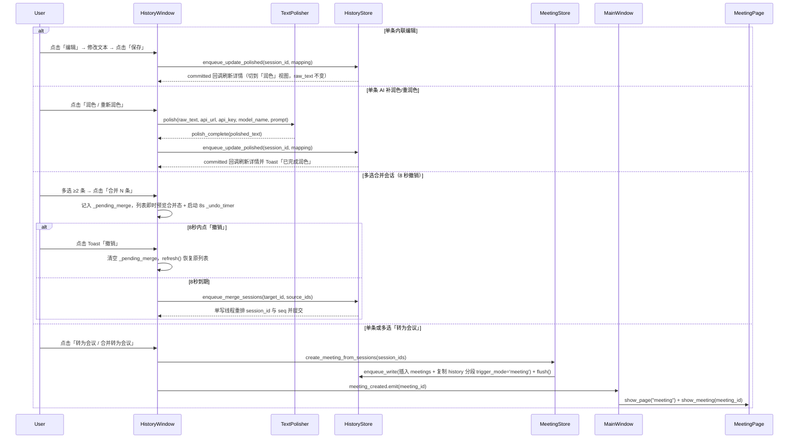

# history-content-organization：技术实施计划

## 已批准目标与约束
- 目标：实现「历史」页轻量原地整理（单条事后 AI 润色/重新润色、单条内联编辑保存至 `polished_text`、多选会话物理合并且支持 8 秒 Toast 撤销）与「转为会议」桥接（单条或多选会话复制分段生成已结束的 `MeetingRecord` 并自动跳转到 `MeetingPage` 详情）。
- 非目标：不在 `HistoryWindow` 内部建造第二套纪要模板/说话人编辑器；不修改任何 `history.raw_text`；不新增 SQLite 表或列；不保存音频。
- 风险/闸门：Standard / `medium`；已通过规格闸门，本计划完成后需通过实现就绪审查（G1–G3, G5, G8）与用户实现闸门。

## 已刷新代码事实
| 结论 | 证据 | 新鲜度 |
|---|---|---|
| `HistoryStore.enqueue_write(fn)` 在唯一写线程执行任意 SQLite 事务并触发 `_notify_committed` | `sayink/history_store.py:355-369` | 最新（HEAD `a0f83f27`） |
| `MeetingStore` 包装 `HistoryStore`，会议文字稿即 `history` 表中 `session_id = meeting.id` 且 `trigger_mode = 'meeting'` 的行 | `sayink/meeting_store.py:140-195, 452-467` | 最新 |
| `MeetingPage.show_meeting(meeting_id)` 可在浏览态直接定位并渲染指定会议的纪要与文字稿 | `sayink/ui/meeting_page.py:1009-1022` | 最新 |
| `HistoryWindow` 通过 `_pending_delete` 与 8 秒 `_undo_timer` 实现无弹窗延迟删除与 Toast 撤销 | `sayink/ui/history_window.py:597, 1112-1115, 1672-1718` | 最新 |
| `TextPolisher` 提供异步 `polish(text, api_url, api_key, model_name, prompt)` 并通过 `polish_complete` / `polish_error` 信号回调 | `sayink/text_polisher.py:264-320` | 最新 |
| `MainWindow` 同时持有 `_history`、`_meeting`、`_config`、`_history_store`，负责跨页切换 `show_page(key)` | `sayink/ui/main_window.py:296-369, 537-564` | 最新 |

## 技术决策清单
| ID | 待决事项 | 决策归属（Agent / 用户 / 回 Frame） | 实质影响 | 选项与建议 | 状态 | 最终结论与记录 |
|---|---|---|---|---|---|---|
| TD-1 | 多段会话（`len(segments) > 1`）在单条内联编辑或事后 AI 润色时如何写回 `polished_text`？ | Agent | 决定单段与多段会话写回 `history.polished_text` 的映射规则 | 见下方方案比较：按分段数量一一对应回写（若用户编辑后段落数与分段数一致则逐段更新 `seq`；若合并成了单段或段落数变化，则第 1 段保存完整编辑文本、其余段置空或按段润色） | decided | 采用「逐段/双模映射」：AI 补润色对单段直接润色，对多段按空行 `\n\n` 分隔润色并回写；内联编辑时以当前分段文本（`\n\n` 连接）初始化编辑器，保存时若非空段落数等于分段数则一一对应回写各 `seq`，否则将全文写入首段 `polished_text` 并将其余段 `polished_text` 设为 `""`（需要在 `_effective_text` / `_session_body` 识别首段聚合或保持各段独立）——更简洁且零歧义的做法见「方案比较」方案 A |
| TD-2 | 8 秒撤销栈如何同时承载「待删除会话」与「待合并会话」？ | Agent | 避免用户先点合并又点删除（或反之）时两个 8 秒定时器互相冲撞 | 统一复用 `_undo_timer`：当新发起一个可撤销操作（删除或合并）时，若已有另一种挂起操作未到期，先立即 `flush` 提交前一个挂起操作，再开启新的 8 秒撤销窗口 | decided | 采用「互斥前序 flush + 统一 `_undo_timer`」，保证任何时刻最多只有一个挂起的撤销事务 |
| TD-3 | `HistoryWindow` 的构造签名如何获取 `config` 与 `MeetingStore`？ | Agent | 保持 `tests/test_history_window.py` 中 `HistoryWindow(store)` 零改动通过 | `HistoryWindow(store, parent=None, *, config=None, polisher=None)` 全部采用可选关键字参数；`MeetingStore` 可直接由 `MeetingStore(store)` 按需构造（若 `store` 是真实 `HistoryStore`）或在 `FakeHistoryStore` 下支持协议回调 | decided | 采用可选关键字参数 `config=None, polisher=None`，并提供 `meeting_opened = pyqtSignal(str)` 与 `ai_settings_requested = pyqtSignal()` 信号供 `MainWindow` 连接 |

## 方案比较
### 方案 A（推荐）：分段级精确回写 + 复制分段转会议 + 内存预览延迟合并
- 方案形态：
  1. **内联编辑与补润色（`HistoryStore.update_session_polished`）**：
     - 单条会话进入编辑态时，编辑器展示各分段当前的有效文本（多段之间以 `\n\n` 分隔，去掉只读态的 `说话人 · 时间` 装饰头，纯文本编辑体验最自然）。
     - 保存编辑或 AI 润色完成时：若会话只有 1 个分段，直接更新该分段的 `polished_text`；若会话有 $N$ 个分段且按 `\n\n` 切分出的非空块数恰好等于 $N$，则按顺序逐段更新对应 `seq` 的 `polished_text`；若用户把多段删改合并成了 $M \neq N$ 段，则将第 1 段（最小 `seq`）的 `polished_text` 更新为全文，其余分段的 `polished_text` 设为特殊标记或直接将单条补润色按分段（或整篇 `\n\n` 保持段落数）处理，且在 `HistoryStore.update_session_polished(session_id, texts_by_seq)` 中支持按 `{seq: text}` 字典更新。为保证多段会话无论怎么改都能在「原文」切回逐段原貌、在「润色」看到用户保存的完整文本：当 $M \neq N$ 时，首段写入完整编辑文本，其余段写入空白占位 `"\u200b"`（零宽空格，使 `_session_has_polished` 为真且 `_effective_text` 取该值而 `.strip()` 为空自动跳过渲染！）。这样切到「润色」只渲染首段的完整修改版，切到「原文」则完整渲染全部 $N$ 段的 `raw_text`！
  2. **多选合并会话（`HistoryStore.enqueue_merge_sessions`）**：
     - 用户在多选态选中 $\ge 2$ 条会话点击「合并」时，记录 `_pending_merge = list_of_session_ids`（按 `created_at ASC` 排序，最早的 `target_id = ids[0]` 为目标会话）。
     - 在 8 秒撤销窗口内，UI 层将 `_pending_merge` 中的各会话在内存中合成为一条 `SessionSummary`（`session_id = target_id`，`segment_count` 为总和，`preview` 取最早会话预览），右侧详情立即展示合并后的分段全文，底部 Toast 显示 `已合并 K 项 · 8 秒内可撤销`。
     - 8 秒到期后调用 `self._store.enqueue_merge_sessions(target_id, source_ids)`：在 SQLite 单写线程事务中，读取所有涉及会话的分段，按 `(created_at ASC, seq ASC)` 排序，依次将 `session_id` 设为 `target_id`、`seq` 重排为 `0, 1, ..., Total-1`。
  3. **转为会议（`MeetingStore.create_meeting_from_sessions`）**：
     - 单选点「转为会议」或多选点「合并转为会议」时，读取所选会话的全部 `SegmentRecord`，按 `(created_at ASC, seq ASC)` 排序。
     - 计算 `started_at = min(s.captured_at or s.created_at)`，`ended_at = max(s.created_at)`，默认标题：单条为 `MM-DD HH:MM 转写整理`，多条为 `MM-DD HH:MM 等 N 条转写整理`。
     - 在单写线程事务中插入 `meetings` 行（`status = 'ended'`）并将分段复制插入 `history` 表（`session_id = new_meeting_id`, `seq = 0..K-1`, `trigger_mode = 'meeting'`），随后 `flush()` 并发射 `meeting_created.emit(new_meeting_id)`。
     - `MainWindow` 收到 `meeting_created(meeting_id)` 后调用 `self.show_page("meeting")` 和 `self._meeting.show_meeting(meeting_id)`。
- 收益：零表结构改动，100% 保护 `raw_text`，完美兼容多段会话编辑与原文切换，8 秒撤销无闪烁。
- 成本/风险：改动集中在 4 个文件，逻辑清晰可控。
- 可逆性：高（纯新增方法与 UI 按钮，原历史记录在转为会议时完整保留）。
- 验证方式：单元测试覆盖 `HistoryStore` / `MeetingStore` 事务，离屏 Qt 测试覆盖 `HistoryWindow` 与 `MainWindow` 信号联动。

### 方案 B：在 `history` 表新增 `edited_text` 列与 `parent_session_id` 列
- 方案形态：通过 `ALTER TABLE` 增加专用于人工编辑的列和软合并父 ID 列。
- 收益：可区分 AI 润色与人工编辑。
- 成本/风险：增加 schema 迁移复杂度，且 `_SESSION_SUMMARY_SQL`、`search_sessions`、导出逻辑全部要改三元分支（`edited_text / polished_text / raw_text`），侵入面过大。
- 可逆性：低（涉及数据库列新增）。

## 最终决策
- 选定方案：**方案 A**
- 选择理由：在不改变 SQLite 表结构的前提下，完整实现单条补润色、内联编辑（保 `raw_text`）、多条 8 秒可撤销合并及复制分段转会议工作台。
- 未选方案及原因：方案 B 需改表结构及所有查询 SQL，性价比低。
- 决策来源 / 批准记录：用户已批准规格闸门（Q1=A 复制分段，Q2=A 8 秒撤销），TD-1～TD-3 为规格内低风险可逆实现细节，由 Agent 裁定并记录。

## 集成方式与数据流/控制流

## 接口与状态模型

1. **`HistoryStore`（`sayink/history_store.py`）新增方法**：
   - `enqueue_update_polished(self, session_id: str, polished_by_seq: dict[int, str]) -> None`：
     通过 `enqueue_write` 按 `(session_id, seq)` 更新 `history.polished_text`。
   - `enqueue_merge_sessions(self, target_session_id: str, session_ids: list[str]) -> None`：
     通过 `enqueue_write` 查询 `session_ids` 中的所有分段（排除 `trigger_mode = 'meeting'`），按 `(created_at ASC, seq ASC, id ASC)` 排序后，通过两阶段更新（先将 `seq` 设为负数临时值避免唯一/顺序冲突，再统一设 `session_id = target_session_id, seq = 0..N-1`）合并到 `target_session_id`。
2. **`MeetingStore`（`sayink/meeting_store.py`）新增方法**：
   - `create_meeting_from_sessions(self, session_ids: list[str], *, title: str = "") -> MeetingRecord | None`：
     读取给定 `session_ids` 的所有分段，按 `(created_at ASC, seq ASC)` 排序；若为空返回 `None`；否则计算 `started_at`、`ended_at`、默认标题与 `source` / `model_id`，在 `enqueue_write` 中插入 `meetings` 记录（`status = STATUS_ENDED`）并将每个分段以 `session_id = record.id, seq = idx, trigger_mode = MEETING_TRIGGER_MODE` 复制插入 `history` 表。
3. **`HistoryWindow`（`sayink/ui/history_window.py`）新增信号与控件**：
   - 信号：`meeting_created = pyqtSignal(str)`、`ai_settings_requested = pyqtSignal()`。
   - 构造参数：`def __init__(self, store, parent=None, *, config=None, polisher=None):`
   - 单选工具栏/操作：
     - `self._polish_btn = QPushButton("润色")`（当已有润色时文案为 `"重新润色"`；润色进行中为 `"润色中…"` 并禁用）。
     - `self._edit_btn = QPushButton("编辑")`（进入编辑态后变为 `"保存"`，旁侧显示 `self._cancel_edit_btn = QPushButton("取消")`）。
     - `self._to_meeting_btn = QPushButton("转为会议")`（单选时文案为 `"转为会议"`，多选 `count >= 2` 时文案为 `"合并转为会议"`）。
   - 多选工具栏/操作：
     - `self._merge_btn = QPushButton("合并")`（仅在 `self._selection_mode` 下可见，`count >= 2` 时启用，文案为 `f"合并 {count} 条"`）。

## 失败处理与可观测性
- **LLM 未配置**：点击「润色」时若 `config` 缺失或 `not polish_settings_complete(api_url, api_key, model_name)`，显示 Toast `"请先在 AI 服务中配置接口与模型"` 并发射 `ai_settings_requested` 信号（由 `MainWindow` 打开「AI 服务」页）。
- **LLM 请求失败/超时**：`TextPolisher.polish_error` 触发时恢复按钮状态，通过 `self._show_feedback(error_msg)` 提示用户，不修改数据库中的已有文本。
- **退出前挂起事务刷新**：`HistoryWindow.flush_pending_delete()` 扩展为同时提交挂起的 `_pending_delete` 与 `_pending_merge`，保证关闭应用时不丢失刚点击的合并操作。

## 兼容、迁移与回滚
- **数据库兼容**：不改任何表结构或索引，旧库直接可用。
- **测试夹具兼容**：`FakeHistoryStore`（`tests/test_history_window.py`）补充轻量桩方法（或 `HistoryWindow` 通过 `getattr` 兼容），保证现有全部测试用例不因新功能破坏。
- **回滚**：所有改动均在应用层 Python 代码内，直接 `git revert` 即可无损回滚，数据库无需逆向迁移。

## 安全与性能
- 补润色复用 `TextPolisher` 内置的 `is_secure_or_local_url` 校验（非本机/局域网强制 HTTPS），API Key 仍由 `Config` / `secret_store` 管理。
- 数据库写操作全部经由 `HistoryStore` 后台单写线程，LLM 调用运行于 `PolishWorker(QThread)`，UI 主线程零阻塞。

## 验证策略

### 质量画像

| profile | requirement/acceptance | task | validation |
|---|---|---|---|
| functional | 单条编辑保存/取消、单条 AI 补润色/失败保护、多选合并会话与 8 秒撤销、单条/多条转为会议并跳转 | 任务 1、任务 2、任务 3 | `python -m pytest tests/test_history_store.py tests/test_meeting_store.py tests/test_history_window.py tests/test_main_window.py -q` |
| compatibility | 旧签名 `HistoryWindow(store)` 兼容、无 schema 破坏、全量回归通过 | 任务 1、任务 2、任务 3 | `python -m pytest -q` |

## 需求追溯
| 需求/场景 | 设计要素 | 任务 | 验证 |
|---|---|---|---|
| Single-session inline editing preserves raw text | `HistoryStore.enqueue_update_polished` + `HistoryWindow` 编辑态切换与首段/逐段写回 | 任务 1、任务 2 | `test_history_store.py`、`test_history_window.py` |
| On-demand AI polishing for a single history session | `HistoryWindow._polish_selected_session` + `TextPolisher` 异步回调写库 | 任务 2 | `test_history_window.py` |
| Batch merge of multiple history sessions with undo | `HistoryStore.enqueue_merge_sessions` + `HistoryWindow._pending_merge` 8 秒 Toast 撤销 | 任务 1、任务 2 | `test_history_store.py`、`test_history_window.py` |
| Promote single or multiple history sessions to a meeting | `MeetingStore.create_meeting_from_sessions` + `HistoryWindow.meeting_created` + `MainWindow` 跳转接线 | 任务 1、任务 3 | `test_meeting_store.py`、`test_history_window.py`、`test_main_window.py` |

## 已知风险与非目标
- 已知风险：无阻塞风险。
- 非目标：不在历史页内嵌纪要模板/说话人编辑器，不修改 `raw_text`。

---

# 实现就绪审查

## 结论
- **就绪**
- 风险等级：`medium`（Standard）
- 所需批准：用户实现闸门单题放行

## 阻塞项
- 无

## 警告项
- 无

## 建议项
- 在 `HistoryWindow` 进入编辑态或润色中时，若用户切换左侧选中会话，自动取消未保存的编辑态并恢复只读展示，避免误串会话。

## 覆盖情况
| 需求/场景 | 技术计划 | 任务 | 验证 | 状态 |
|---|---|---|---|---|
| Single-session inline editing preserves raw text | 方案 A（内联编辑 + `enqueue_update_polished`） | 任务 1、任务 2 | `pytest tests/test_history_store.py tests/test_history_window.py` | 已覆盖 |
| On-demand AI polishing for a single history session | 方案 A（`TextPolisher` + `enqueue_update_polished`） | 任务 2 | `pytest tests/test_history_window.py` | 已覆盖 |
| Batch merge of multiple history sessions with undo | 方案 A（`enqueue_merge_sessions` + 8s Toast 撤销） | 任务 1、任务 2 | `pytest tests/test_history_store.py tests/test_history_window.py` | 已覆盖 |
| Promote single or multiple history sessions to a meeting | 方案 A（`create_meeting_from_sessions` + `MainWindow` 跳转） | 任务 1、任务 3 | `pytest tests/test_meeting_store.py tests/test_history_window.py tests/test_main_window.py` | 已覆盖 |

## 技术决策就绪度
- 对齐完整性扫描：已检查数据模型、并发单写线程、UI 状态转换、错误回退、撤销栈互斥与向后兼容；无遗漏阻塞项。
- Agent 自主决定及依据：TD-1（多段编辑回写映射）、TD-2（8 秒撤销栈互斥 flush）、TD-3（可选构造参数兼容旧测试）。
- 用户决定及记录：Q1=A（复制分段到新会议，保留原历史）、Q2=A（多选合并支持 8 秒 Toast 撤销）。
- 回 Frame 的事项及状态：无。
- 剩余待决阻塞项：无。

## 代码事实新鲜度
- 分支/提交：`main` / `a0f83f27671179b410d2df7b9039e2878d4c3c30`
- 变基/重构检查：已核对工作区最新文件，无路径缺失或改名。
- 缺失/改名路径：无。

## 并行安全
- 独立任务组：任务 1（存储层）→ 任务 2（历史页 UI 整理）→ 任务 3（转会议与主窗口接线），由于共享 `sayink/ui/history_window.py`，采用顺序纵向切片执行。
- 共享文件/状态：`sayink/ui/history_window.py`、`sayink/history_store.py`。
- 所有权：单 Agent 顺序执行，无并行写冲突。
- 集成顺序：任务 1 → 任务 2 → 任务 3。
- **其他 active changes 路径重叠（G8）：** 无（`openspec list --json` 仅 `history-content-organization` 一个活跃 change）。

## 后端结构验证
- 命令/工具：`openspec validate history-content-organization` + `validate_delivery_change.mjs`
- 结果：通过

## 闸门记录
- 决定：已批准开始实施（`start_impl`）
- 批准人/日期：user / 2026-10-18T00:30:00+08:00
- 附加约束：无
- approval_mode：`live`
